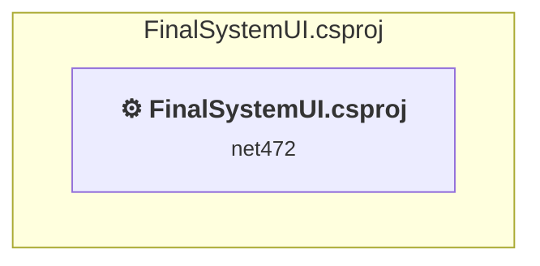

# Projects and dependencies analysis

This document provides a comprehensive overview of the projects and their dependencies in the context of upgrading to .NETCoreApp,Version=v10.0.

## Table of Contents

- [Executive Summary](#executive-Summary)
  - [Highlevel Metrics](#highlevel-metrics)
  - [Projects Compatibility](#projects-compatibility)
  - [Package Compatibility](#package-compatibility)
  - [API Compatibility](#api-compatibility)
  - [Binding Redirect Configuration](#binding-redirect-configuration)
- [Aggregate NuGet packages details](#aggregate-nuget-packages-details)
- [Top API Migration Challenges](#top-api-migration-challenges)
  - [Technologies and Features](#technologies-and-features)
  - [Most Frequent API Issues](#most-frequent-api-issues)
- [Projects Relationship Graph](#projects-relationship-graph)
- [Project Details](#project-details)

  - [FinalSystemUI.csproj](#finalsystemuicsproj)

## Executive Summary

### Highlevel Metrics

| Metric | Count | Status |
| :--- | :---: | :--- |
| Total Projects | 1 | All require upgrade |
| Total NuGet Packages | 0 | All compatible |
| Total Code Files | 54 |  |
| Total Code Files with Incidents | 47 |  |
| Total Lines of Code | 9456 |  |
| Total Number of Issues | 11285 |  |
| Estimated LOC to modify | 11283+ | at least 119.3% of codebase |

### Projects Compatibility

| Project | Target Framework | Difficulty | Package Issues | API Issues | Binding Issues | Est. LOC Impact | Description |
| :--- | :---: | :---: | :---: | :---: | :---: | :---: | :--- |
| [FinalSystemUI.csproj](#finalsystemuicsproj) | net472 | 🟡 Medium | 0 | 11283 | 0 | 11283+ | ClassicWinForms, Sdk Style = False |

### Package Compatibility

| Status | Count | Percentage |
| :--- | :---: | :---: |
| ✅ Compatible | 0 | 0.0% |
| ⚠️ Incompatible | 0 | 0.0% |
| 🔄 Upgrade Recommended | 0 | 0.0% |
| ***Total NuGet Packages*** | ***0*** | ***100%*** |

### API Compatibility

| Category | Count | Impact |
| :--- | :---: | :--- |
| 🔴 Binary Incompatible | 9362 | High - Require code changes |
| 🟡 Source Incompatible | 1921 | Medium - Needs re-compilation and potential conflicting API error fixing |
| 🔵 Behavioral change | 0 | Low - Behavioral changes that may require testing at runtime |
| ✅ Compatible | 9094 |  |
| ***Total APIs Analyzed*** | ***20377*** |  |

## Aggregate NuGet packages details

| Package | Current Version | Suggested Version | Projects | Description |
| :--- | :---: | :---: | :--- | :--- |

## Top API Migration Challenges

### Technologies and Features

| Technology | Issues | Percentage | Migration Path |
| :--- | :---: | :---: | :--- |
| Windows Forms | 9361 | 83.0% | Windows Forms APIs for building Windows desktop applications with traditional Forms-based UI that are available in .NET on Windows. Enable Windows Desktop support: Option 1 (Recommended): Target net9.0-windows; Option 2: Add <UseWindowsDesktop>true</UseWindowsDesktop>; Option 3 (Legacy): Use Microsoft.NET.Sdk.WindowsDesktop SDK. |
| GDI+ / System.Drawing | 1700 | 15.1% | System.Drawing APIs for 2D graphics, imaging, and printing that are available via NuGet package System.Drawing.Common. Note: Not recommended for server scenarios due to Windows dependencies; consider cross-platform alternatives like SkiaSharp or ImageSharp for new code. |
| Windows Forms Legacy Controls | 539 | 4.8% | Legacy Windows Forms controls that have been removed from .NET Core/5+ including StatusBar, DataGrid, ContextMenu, MainMenu, MenuItem, and ToolBar. These controls were replaced by more modern alternatives. Use ToolStrip, MenuStrip, ContextMenuStrip, and DataGridView instead. |
| Legacy Configuration System | 11 | 0.1% | Legacy XML-based configuration system (app.config/web.config) that has been replaced by a more flexible configuration model in .NET Core. The old system was rigid and XML-based. Migrate to Microsoft.Extensions.Configuration with JSON/environment variables; use System.Configuration.ConfigurationManager NuGet package as interim bridge if needed. |

### Most Frequent API Issues

| API | Count | Percentage | Category |
| :--- | :---: | :---: | :--- |
| T:System.Windows.Forms.Label | 1349 | 12.0% | Binary Incompatible |
| T:System.Windows.Forms.Button | 1022 | 9.1% | Binary Incompatible |
| T:System.Windows.Forms.GroupBox | 661 | 5.9% | Binary Incompatible |
| T:System.Windows.Forms.Control.ControlCollection | 393 | 3.5% | Binary Incompatible |
| P:System.Windows.Forms.Control.Controls | 393 | 3.5% | Binary Incompatible |
| T:System.Drawing.Font | 388 | 3.4% | Source Incompatible |
| M:System.Windows.Forms.Control.ControlCollection.Add(System.Windows.Forms.Control) | 380 | 3.4% | Binary Incompatible |
| T:System.Drawing.FontStyle | 350 | 3.1% | Source Incompatible |
| T:System.Windows.Forms.TextBox | 345 | 3.1% | Binary Incompatible |
| T:System.Drawing.GraphicsUnit | 326 | 2.9% | Source Incompatible |
| P:System.Windows.Forms.Control.Size | 287 | 2.5% | Binary Incompatible |
| P:System.Windows.Forms.Control.Location | 277 | 2.5% | Binary Incompatible |
| P:System.Windows.Forms.Control.Name | 259 | 2.3% | Binary Incompatible |
| T:System.Windows.Forms.DataGridView | 249 | 2.2% | Binary Incompatible |
| P:System.Windows.Forms.Control.TabIndex | 219 | 1.9% | Binary Incompatible |
| P:System.Windows.Forms.Control.Font | 190 | 1.7% | Binary Incompatible |
| T:System.Windows.Forms.FlatStyle | 165 | 1.5% | Binary Incompatible |
| F:System.Drawing.GraphicsUnit.Point | 163 | 1.4% | Source Incompatible |
| M:System.Drawing.Font.#ctor(System.String,System.Single,System.Drawing.FontStyle,System.Drawing.GraphicsUnit,System.Byte) | 163 | 1.4% | Source Incompatible |
| P:System.Windows.Forms.Control.ForeColor | 154 | 1.4% | Binary Incompatible |
| P:System.Windows.Forms.Label.Text | 137 | 1.2% | Binary Incompatible |
| F:System.Drawing.FontStyle.Bold | 120 | 1.1% | Source Incompatible |
| T:System.Data.SqlClient.SqlParameter | 118 | 1.0% | Source Incompatible |
| E:System.Windows.Forms.Control.Click | 113 | 1.0% | Binary Incompatible |
| M:System.Windows.Forms.Label.#ctor | 111 | 1.0% | Binary Incompatible |
| T:System.Windows.Forms.ComboBox | 93 | 0.8% | Binary Incompatible |
| T:System.Windows.Forms.PictureBox | 91 | 0.8% | Binary Incompatible |
| P:System.Windows.Forms.Control.BackColor | 89 | 0.8% | Binary Incompatible |
| P:System.Windows.Forms.ButtonBase.Text | 75 | 0.7% | Binary Incompatible |
| T:System.Windows.Forms.DockStyle | 75 | 0.7% | Binary Incompatible |
| P:System.Windows.Forms.ButtonBase.UseVisualStyleBackColor | 67 | 0.6% | Binary Incompatible |
| M:System.Windows.Forms.Button.#ctor | 66 | 0.6% | Binary Incompatible |
| T:System.Windows.Forms.DialogResult | 63 | 0.6% | Binary Incompatible |
| F:System.Drawing.FontStyle.Regular | 55 | 0.5% | Source Incompatible |
| P:System.Windows.Forms.TextBox.Text | 55 | 0.5% | Binary Incompatible |
| T:System.Windows.Forms.CheckBox | 51 | 0.5% | Binary Incompatible |
| F:System.Windows.Forms.FlatStyle.Popup | 49 | 0.4% | Binary Incompatible |
| M:System.Windows.Forms.Control.ResumeLayout(System.Boolean) | 46 | 0.4% | Binary Incompatible |
| M:System.Windows.Forms.Control.SuspendLayout | 46 | 0.4% | Binary Incompatible |
| P:System.Windows.Forms.ButtonBase.BackColor | 45 | 0.4% | Binary Incompatible |
| T:System.Windows.Forms.FormStartPosition | 39 | 0.3% | Binary Incompatible |
| T:System.Windows.Forms.Form | 38 | 0.3% | Binary Incompatible |
| P:System.Windows.Forms.GroupBox.TabStop | 37 | 0.3% | Binary Incompatible |
| M:System.Windows.Forms.GroupBox.#ctor | 37 | 0.3% | Binary Incompatible |
| M:System.Windows.Forms.TextBox.#ctor | 36 | 0.3% | Binary Incompatible |
| T:System.Windows.Forms.AutoScaleMode | 36 | 0.3% | Binary Incompatible |
| T:System.Windows.Forms.FormBorderStyle | 33 | 0.3% | Binary Incompatible |
| M:System.Windows.Forms.Control.FindForm | 30 | 0.3% | Binary Incompatible |
| P:System.Windows.Forms.GroupBox.FlatStyle | 30 | 0.3% | Binary Incompatible |
| P:System.Windows.Forms.Label.AutoSize | 27 | 0.2% | Binary Incompatible |

## Projects Relationship Graph

Legend:
📦 SDK-style project
⚙️ Classic project

## Project Details

### FinalSystemUI.csproj

#### Project Info

- **Current Target Framework:** net472
- **Proposed Target Framework:** net10.0-windows
- **SDK-style**: False
- **Project Kind:** ClassicWinForms
- **Dependencies**: 0
- **Dependants**: 0
- **Number of Files**: 67
- **Number of Files with Incidents**: 47
- **Lines of Code**: 9456
- **Estimated LOC to modify**: 11283+ (at least 119.3% of the project)

#### Dependency Graph

Legend:
📦 SDK-style project
⚙️ Classic project

### API Compatibility

| Category | Count | Impact |
| :--- | :---: | :--- |
| 🔴 Binary Incompatible | 9362 | High - Require code changes |
| 🟡 Source Incompatible | 1921 | Medium - Needs re-compilation and potential conflicting API error fixing |
| 🔵 Behavioral change | 0 | Low - Behavioral changes that may require testing at runtime |
| ✅ Compatible | 9094 |  |
| ***Total APIs Analyzed*** | ***20377*** |  |

#### Project Technologies and Features

| Technology | Issues | Percentage | Migration Path |
| :--- | :---: | :---: | :--- |
| Legacy Configuration System | 11 | 0.1% | Legacy XML-based configuration system (app.config/web.config) that has been replaced by a more flexible configuration model in .NET Core. The old system was rigid and XML-based. Migrate to Microsoft.Extensions.Configuration with JSON/environment variables; use System.Configuration.ConfigurationManager NuGet package as interim bridge if needed. |
| GDI+ / System.Drawing | 1700 | 15.1% | System.Drawing APIs for 2D graphics, imaging, and printing that are available via NuGet package System.Drawing.Common. Note: Not recommended for server scenarios due to Windows dependencies; consider cross-platform alternatives like SkiaSharp or ImageSharp for new code. |
| Windows Forms Legacy Controls | 539 | 4.8% | Legacy Windows Forms controls that have been removed from .NET Core/5+ including StatusBar, DataGrid, ContextMenu, MainMenu, MenuItem, and ToolBar. These controls were replaced by more modern alternatives. Use ToolStrip, MenuStrip, ContextMenuStrip, and DataGridView instead. |
| Windows Forms | 9361 | 83.0% | Windows Forms APIs for building Windows desktop applications with traditional Forms-based UI that are available in .NET on Windows. Enable Windows Desktop support: Option 1 (Recommended): Target net9.0-windows; Option 2: Add <UseWindowsDesktop>true</UseWindowsDesktop>; Option 3 (Legacy): Use Microsoft.NET.Sdk.WindowsDesktop SDK. |

